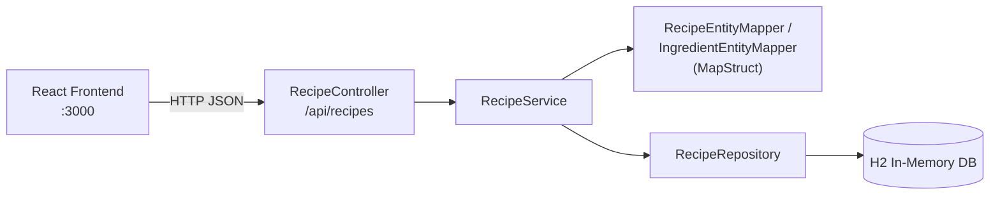
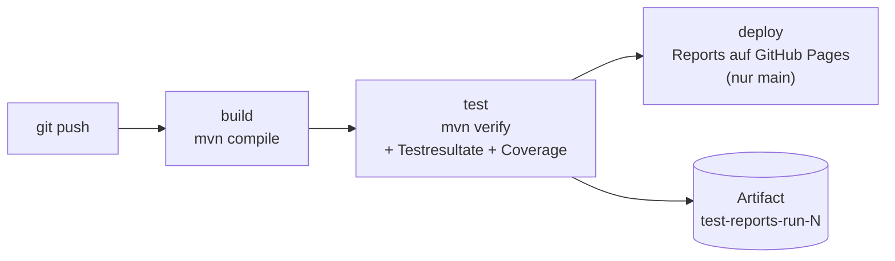

# Block 08 – CI/CD Pipeline

Dieses Modul behandelt das automatisierte Bauen und Testen bei jedem Push mit einer **Build-Pipeline**, inkl. automatisch erzeugter und einsehbarer **Test- und Coverage-Reports**.

| Ordner / Datei | Inhalt |
| :--- | :--- |
| [`recipe-planner-backend/`](./recipe-planner-backend/) | Vorgabe: Spring Boot Backend – inkl. Tests (Aufgabe 1) und Report-Konfiguration (Aufgabe 2) |
| [`recipe-planner-frontend/`](./recipe-planner-frontend/) | Vorgabe: React Frontend – unverändert, nur zum Verständnis |
| [`../.github/workflows/recipe-planner-backend.yml`](../.github/workflows/recipe-planner-backend.yml) | Aufgabe 3 – Pipeline (GitHub Actions) |

---

## Inbetriebnahme

### Anpassungen gegenüber der Vorgabe
* **Maven Wrapper** ergänzt (fehlte in der Vorgabe).
* Java-Version einheitlich auf **17** (die Vorgabe definierte `maven.compiler.source/target = 20`, der Compiler-Plugin verwendete aber `${java.version}` von Spring Boot = 17).
* Test-Dependency **REST Assured** sowie die Plugins **Surefire Report** und **JaCoCo** für die Reports ergänzt.
* IDE-/Systemdateien (`.iml`, `.DS_Store`) entfernt, `.gitignore` für das Frontend ergänzt.

### Starten
```powershell
# Backend (http://localhost:8080/api/recipes)
cd 08-ci-cd-pipeline\recipe-planner-backend
.\mvnw.cmd spring-boot:run

# Frontend (http://localhost:3000)
cd 08-ci-cd-pipeline\recipe-planner-frontend
npm install
npm start
```

### Aufbau des Backends

* **Domänenklassen** (`Recipe`, `Ingredient`, `Unit`) werden über die REST-API ausgetauscht, **Entities** (`RecipeEntity`, `IngredientEntity`) in der Datenbank gespeichert.
* Die **Mapper** sind Interfaces; **MapStruct** generiert die Implementation (`*MapperImpl`) beim Kompilieren.
* Beim Start werden 15 Demo-Rezepte erstellt.

| Endpoint | Beschreibung |
| :--- | :--- |
| `GET /api/recipes` | Alle Rezepte |
| `GET /api/recipes/recipe/{recipeId}` | Ein Rezept per UUID |
| `POST /api/recipes` | Rezept erstellen (IDs werden generiert) |

---

## Aufgabe 1: Unit Testing

### 1. Controller-Methoden
| Testklasse | Methode | Was wird getestet |
| :--- | :--- | :--- |
| [`RecipeControllerTest`](./recipe-planner-backend/src/test/java/ch/tbz/recipe/planner/controller/RecipeControllerTest.java) | **MockMvc** (`@WebMvcTest`, Service mit `@MockBean` gemockt) | Alle 3 Endpoints: Statuscodes, JSON-Inhalt, Weitergabe an den Service (`ArgumentCaptor`), ungültige UUID / ungültiges JSON / unbekannte `Unit` → `400`, CORS für `localhost:3000` |
| [`RecipeControllerIntegrationTest`](./recipe-planner-backend/src/test/java/ch/tbz/recipe/planner/controller/RecipeControllerIntegrationTest.java) | **REST Assured** (`@SpringBootTest`, echter Server + H2) | Demo-Rezepte laden, Rezept erstellen → per ID abrufen → in Liste vorhanden, generierte IDs |

**Befund (dokumentiert, nicht geändert)**: `GET /api/recipes/recipe/{id}` mit einer **unbekannten** ID liefert `200 OK` mit **leerem Body** statt `404 Not Found`, da der Service `null` zurückgibt. Die Tests halten dieses aktuelle Verhalten fest (`unknownRecipe`, `unknownId`).

**Stolperstein**: `@WebMvcTest` lädt auch die Klasse `RecipePlannerApplication` mit dem `CommandLineRunner` für die Demo-Daten. Dieser benötigt das `RecipeRepository` – deshalb wird es im Test ebenfalls als `@MockBean` bereitgestellt.

### 2. Mapper mit SoftAssertions
| Testklasse | Inhalt |
| :--- | :--- |
| [`IngredientEntityMapperTest`](./recipe-planner-backend/src/test/java/ch/tbz/recipe/planner/mapper/IngredientEntityMapperTest.java) | Entity ↔ Domain, alle `Unit`-Werte (`@EnumSource`), `null`-Felder, `null`-Input, Listen, Round Trip |
| [`RecipeEntityMapperTest`](./recipe-planner-backend/src/test/java/ch/tbz/recipe/planner/mapper/RecipeEntityMapperTest.java) | Entity ↔ Domain inkl. **verschachtelter Zutaten**, neue Rezepte ohne IDs, `null`/leere Zutatenliste, Round Trip (Deep Copy) |

Es werden drei Varianten von SoftAssertions gezeigt:
```java
// 1. JUnit-5-Extension: assertAll() wird nach jedem Test automatisch aufgerufen
@ExtendWith(SoftAssertionsExtension.class)
class IngredientEntityMapperTest {
    @InjectSoftAssertions
    private SoftAssertions softly;
}

// 2. Lambda
assertSoftly(softly -> {
    softly.assertThat(recipe.getName()).isEqualTo("Pizza Margherita");
    softly.assertThat(recipe.getIngredients()).hasSize(2);
});

// 3. Explizit
SoftAssertions softly = new SoftAssertions();
softly.assertThat(entity.getName()).isEqualTo("Pancakes");
softly.assertAll();
```

### Vorteil von SoftAssertions
| Normale Assertions (*hard*) | SoftAssertions |
| :--- | :--- |
| Test bricht bei der **ersten** fehlgeschlagenen Assertion ab. | **Alle** Assertions werden ausgeführt, die Fehler am Schluss **gesammelt** gemeldet. |
| Bei 3 falsch gemappten Feldern sieht man nur das erste → korrigieren, erneut ausführen, nächstes Feld … | Man sieht **sofort alle** falschen Felder in einem Durchlauf. |
| Gut für voneinander abhängige Prüfungen (z. B. „Objekt nicht `null`“ vor Zugriff auf Felder). | Ideal für **viele unabhängige Prüfungen** auf einem Objekt – genau der Fall bei Mappern. |

Schematische Fehlermeldung mit SoftAssertions (vereinfacht – zwei Fehler werden in **einem** Lauf gemeldet):
```
Multiple Failures (2 failures)
-- failure 1 --
expected: "Tomato"  but was: "Tomatoes"
-- failure 2 --
expected: PIECE  but was: GRAMM
```

---

## Aufgabe 2: Reports

Bei jedem `mvn verify` werden automatisch erzeugt:

| Report | Plugin | Pfad |
| :--- | :--- | :--- |
| Testresultate (XML, maschinenlesbar) | `maven-surefire-plugin` | `target/surefire-reports/TEST-*.xml` |
| **Testresultate (HTML)** | `maven-surefire-report-plugin` (`report-only`, Phase `verify`) | `target/site/surefire-report.html` |
| **Code Coverage (HTML, CSV, XML)** | `jacoco-maven-plugin` (Agent + `report`, Phase `verify`) | `target/site/jacoco/index.html` |

```powershell
cd 08-ci-cd-pipeline\recipe-planner-backend
.\mvnw.cmd verify
```

### Resultat
* **30 Tests**, alle erfolgreich.

| Klasse | Instructions | Branches | Lines |
| :--- | ---: | ---: | ---: |
| `RecipeController` | 100 % | – | 100 % |
| `RecipeService` | 100 % | – | 100 % |
| `RecipeEntityMapperImpl` | 100 % | 100 % | 100 % |
| `IngredientEntityMapperImpl` | 100 % | 100 % | 100 % |
| `Unit` | 100 % | – | 100 % |

Ausgeschlossen: `RecipePlannerApplication` (Einstiegspunkt mit Demo-Daten) und `CommonMapperConfig` (reine Annotation, keine Logik). Domain-Klassen und Entities erscheinen nicht, da ihr Code vollständig von Lombok generiert wird.

---

## Aufgabe 3: Pipeline (GitHub Actions)

Da das Repository auf **GitHub** liegt, wird die Pipeline mit **GitHub Actions** umgesetzt. Das Prinzip entspricht der GitLab-Pipeline aus der Theorie:

| GitLab (Theorie) | GitHub Actions |
| :--- | :--- |
| `.gitlab-ci.yml` im Hauptverzeichnis | `.github/workflows/*.yml` im Hauptverzeichnis |
| `stages` + Jobs | Jobs mit Abhängigkeiten (`needs`) |
| `image: maven:latest` | `runs-on: ubuntu-latest` + `actions/setup-java` |
| `variables` | `env` |
| `script` | `steps` mit `run` |
| `artifacts` / `reports: junit` | `actions/upload-artifact` + JUnit-Report-Action |
| GitLab Pages (`pages`-Job) | GitHub Pages (`actions/deploy-pages`) |
| Runner | GitHub-hosted Runner (Ubuntu-VM) |

### Ablauf


| Job | Schritte |
| :--- | :--- |
| **build** | Checkout, JDK 17 (Temurin) mit Maven-Cache, `mvn compile` |
| **test** | `mvn verify` (Tests + Reports), **Testresultate im GitHub-UI** (Check „Unit test results“ + Job Summary), **Coverage-Tabelle** in der Job Summary, Reports als **Artifact** (30 Tage), Report-Seite für Pages vorbereiten |
| **deploy** | Nur auf `main`: Reports auf **GitHub Pages** veröffentlichen |

### Trigger
* Jeder **Push** und **Pull Request**, der Dateien unter `08-ci-cd-pipeline/recipe-planner-backend/` oder den Workflow selbst ändert (Pfadfilter – Änderungen an anderen Blöcken lösen die Pipeline nicht aus).
* Manuell über *Actions → Recipe Planner Backend CI → Run workflow*.

### Reports pro Pipeline-Lauf einsehen
1. **Actions-Tab** → Lauf auswählen → **Summary**: Tabelle mit allen Tests und Coverage pro Klasse.
2. **Check „Unit test results“**: einzelne Tests, bei Fehlern mit Annotation direkt an der Codezeile.
3. **Artifact** `test-reports-run-<N>` (unten in der Summary): ZIP mit HTML-Reports und Surefire-XML.
4. **GitHub Pages** (Reports des letzten `main`-Laufs): https://nico-linder.github.io/m450/ – Startseite mit Links zu Testresultaten und Coverage.

### Voraussetzung
GitHub Pages muss einmalig aktiviert sein: *Settings → Pages → Build and deployment → Source: **GitHub Actions***.
